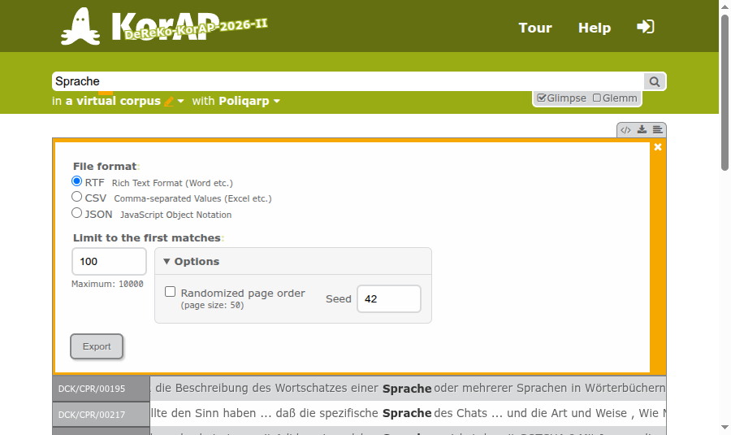

# Kalamar-Plugin-Export



## Description

Kalamar-Plugin-Export provides **RTF**, **CSV**, and **JSON** exports of search
results from the [KorAP Corpus Analysis Platform](https://korap.ids-mannheim.de/).
With [Kalamar](https://github.com/KorAP/Kalamar) 0.67 or later, it serves as the
backend for the built-in export interface. The iframe plugin interface remains
available for legacy integrations.


## Integration with Kalamar

For Kalamar 0.67 or later, configure `KALAMAR_EXPORT_SERVICE` on the **Kalamar
service** with the export service's internal base URL. For example, when both
services share a Docker Compose network and the export service is named `export`:

```yaml
environment:
  KALAMAR_EXPORT_SERVICE: http://export:7777
```

Alternatively, set `export` in the `Kalamar` section of Kalamar's configuration:

```perl
{
  Kalamar => {
    export => 'http://export:7777'
  }
}
```

Kalamar provides the export interface and proxies requests to the export service,
including authentication. Configure the export service to use the same Kustvakt
backend as Kalamar with `KALAMAR_EXPORT_API_HOST`, `KALAMAR_EXPORT_API_PORT`,
`KALAMAR_EXPORT_API_SCHEME`, and, if needed, `KALAMAR_EXPORT_API_PATH`.

The browser accesses the service through Kalamar's `/export/` proxy, so the export
service does not need a public port. Restart Kalamar after changing its
configuration. Iframe plugin registration is only needed for the
[legacy integration](#legacy-integration).

## Docker

The Docker image uses a compact Java 25 runtime linked from Corretto
25.0.5.1.2, which includes the fix for CVE-2026-114938 (Java4Shell).
Build and runtime base images are pinned by digest. Maven tests run on the
linked runtime's module set before the application is packaged.

The final image uses glibc. Alpine-based Java images have caused compatibility
problems on older Docker hosts, including the CoRoLa CentOS 7 server; keep
Alpine confined to the build stage. The runtime retains TLS, authentication,
locale and diagnostic modules, but does not include a compiler or Maven.

To run the service locally for Kalamar's built-in export interface, using the
public KorAP API as its default backend:

```shell
docker run --rm --name korap-export \
  -p 127.0.0.1:7777:7777 \
  -e KALAMAR_EXPORT_SERVER_HOST=0.0.0.0 \
  korap/kalamar-plugin-export:0.5.1
```

Port `7777` is already the default. The host override lets Docker reach the
service, which otherwise listens only on the container's loopback interface.
The published port is restricted to the Docker host's loopback interface.
If Kalamar runs directly on that host, use
`KALAMAR_EXPORT_SERVICE=http://127.0.0.1:7777`.

When Kalamar also runs in Docker, use a shared Compose network and the export
service's Docker service name, such as `http://export:7777`, instead of
`localhost`. The export service must listen on `0.0.0.0` inside its container;
a host port mapping is not needed for communication within the Compose network.

See the [configuration reference](#configuration-reference) for backend settings
and export limits. Bind-mounted export directories must be writable by the
container's service user (UID `100`, GID `101`).

## Prerequisites

For building from source, install a **Java 21 or newer JDK**,
[Git](https://git-scm.com/), and [Maven 3](https://maven.apache.org/).
Further dependencies are resolved using Maven. The published Docker image
provides its own Java 25 runtime.


## Build

To build the latest version of Kalamar-Plugin-Export, do ...

```shell
git clone https://github.com/KorAP/Kalamar-Plugin-Export
cd Kalamar-Plugin-Export
```

... and build the jar file ...


```shell
mvn clean package
```

The JAR is located in `target/` and can be run with Java 21 or newer.
Replace `VERSION` with the built version:

```shell
java -jar target/KalamarExportPlugin-VERSION.jar
```

By default, this starts a server at `http://localhost:7777`. Export files are
stored in Java's temporary directory; set `conf.file_dir` to use another location.

## Legacy integration

For Kalamar deployments using the iframe plugin interface, register the export
form with the following JSON definition:

```json
{
  "name" : "Export",
  "desc" : "Exports Kalamar results",
  "embed" : [{
    "panel" : "result",
    "title" : "exports KWICs and snippets",
    "icon" : "\uf019",
    "classes" : ["button-icon", "plugin" ],
    "onClick" : {
      "action" : "addWidget",
      "template" : "http://localhost:7777/export",
      "permissions":["forms","scripts","downloads"]
    }
  }]
}
```

This template will also be displayed when starting the jar with the argument [-h|--help]. Alternatively it is returned by:

```shell
http://localhost:7777/export/template
```

At the moment the simplest way to register the plugin is by storing the json
blob in a file (the blob needs to be in a list, i.e. surrounded by `[...]`).
The file then can be loaded using the `Plugins` addon in Kalamar using the
Kalamar configuration file.

```perl
{
  Kalamar => {
    plugins => ['Plugins'],
  },
  'Kalamar-Plugins' => {
    default_plugins => 'plugins.json'
  }
}
```

For example, with this configuration addition, the content
of `plugins.json` will be registered on every Kalamar page load.

An [example demo](https://github.com/KorAP/Kalamar/blob/master/dev/demo/export.html)
showcases the embedded plugin.

The legacy iframe integration can reuse the session cookie of the host service.
For this setup, the [Content Security Policy](https://developer.mozilla.org/en-US/docs/Web/HTTP/CSP)
of Kalamar needs to be extended to include the whole domain that
hosts both services (at the moment it's not possible to host the service on a different domain).
If the domain is, e.g., `ids-mannheim.de`, the configuration in the Kalamar configuration
file needs to be:

```perl
{
  CSP => {
    'frame-src' => 'self',
    'frame-ancestors' => ['self','https://*.ids-mannheim.de/']
  }
}
```

## Customization

The basic configuration file is stored in `src/main/resources/exportPlugin.conf`.
To change the configuration create a new config file and run the jar with the
according filename as argument:

```shell
java -jar target/KalamarExportPlugin-VERSION.jar myconf_exportPlugin.conf
```

You can also define only single properties in the new config file. In this case only these properties overwrite the properties in the basic configuration file.

Alternatively a file named `exportPlugin.conf` can be stored in the
working directory from which the service is started.

### Environment Variables

Configuration can also be set via environment variables, which take precedence over
configuration file values. This is particularly useful for Docker deployments and
containerized environments.

The priority order is (highest to lowest):
1. Environment variables
2. Custom configuration file (if provided as argument)
3. Default configuration file (`exportPlugin.conf`)

### Configuration Reference

The following configuration options are available. Each can be set either in a
configuration file (using the property name) or via an environment variable:

#### Server Configuration

- `server.port` or `KALAMAR_EXPORT_SERVER_PORT`: Port of the export server (default: `7777`)
- `server.host` or `KALAMAR_EXPORT_SERVER_HOST`: Host address of the server (default: `localhost`)
- `server.scheme` or `KALAMAR_EXPORT_SERVER_SCHEME`: URL scheme for generated
  legacy plugin URLs (default: `https`). Set to `http` for direct HTTP use of the
  legacy form; this setting does not enable TLS and is not needed for Kalamar's
  built-in integration.
- `server.origin` or `KALAMAR_EXPORT_SERVER_ORIGIN`: CORS origin for SSE responses (default: `*`)

#### API Configuration

- `api.port` or `KALAMAR_EXPORT_API_PORT`: Port of the KorAP API backend (default: `443`)
- `api.host` or `KALAMAR_EXPORT_API_HOST`: Host address of the KorAP API backend (default: `korap.ids-mannheim.de`)
- `api.scheme` or `KALAMAR_EXPORT_API_SCHEME`: URL scheme for the API backend (default: `https`)
- `api.source` or `KALAMAR_EXPORT_API_SOURCE`: Source string for exports, useful when running behind a proxy (optional)
- `api.path` or `KALAMAR_EXPORT_API_PATH`: Additional path prefix for the API (default: empty)

#### Asset Configuration

The built-in export interface uses Kalamar's own assets.

For the legacy export form accessed through Kalamar's `/plugin/export/` proxy,
JavaScript and CSS are loaded from the same Kalamar frontend using relative URLs.
No asset configuration is needed for this proxy setup, including with HTTPS,
a different port, or a reverse-proxy path prefix. The settings below apply to
standalone use of the export form.

- `asset.host` or `KALAMAR_EXPORT_ASSET_HOST`: Host address for assets/stylesheets (default: `korap.ids-mannheim.de`)
- `asset.port` or `KALAMAR_EXPORT_ASSET_PORT`: Port for assets (default: empty, uses default port)
- `asset.scheme` or `KALAMAR_EXPORT_ASSET_SCHEME`: URL scheme for assets (default: `https`)
- `asset.path` or `KALAMAR_EXPORT_ASSET_PATH`: Path prefix for assets (default: empty)

#### Export Configuration

- `conf.page_size` or `KALAMAR_EXPORT_PAGE_SIZE`: Number of matches to fetch per API request (default: `5`)
- `conf.max_exp_limit` or `KALAMAR_EXPORT_MAX_EXP_LIMIT`: Maximum number of matches allowed per export (default: `10000`)
- `conf.file_dir` or `KALAMAR_EXPORT_FILE_DIR`: Directory for temporary export files (default: system temp directory)
- `conf.default_hitc` or `KALAMAR_EXPORT_DEFAULT_HITC`: Default number of hits in the export form (default: `100`)

#### Cookie Configuration

- `cookie.name` or `KALAMAR_EXPORT_COOKIE_NAME`: Name of the Kalamar session cookie (default: `kalamar`)

## License

Copyright (c) 2020-2026, [IDS Mannheim](https://www.ids-mannheim.de/), Germany

Kalamar-Plugin-Export is developed as part of the [KorAP](https://korap.ids-mannheim.de/)
Corpus Analysis Platform at the Leibniz Institute for the German Language
([IDS](https://www.ids-mannheim.de/)).

Kalamar-Plugin-Export is published under the
[BSD-2 License](https://raw.githubusercontent.com/KorAP/Kalamar-Plugin-Export/master/LICENSE).
